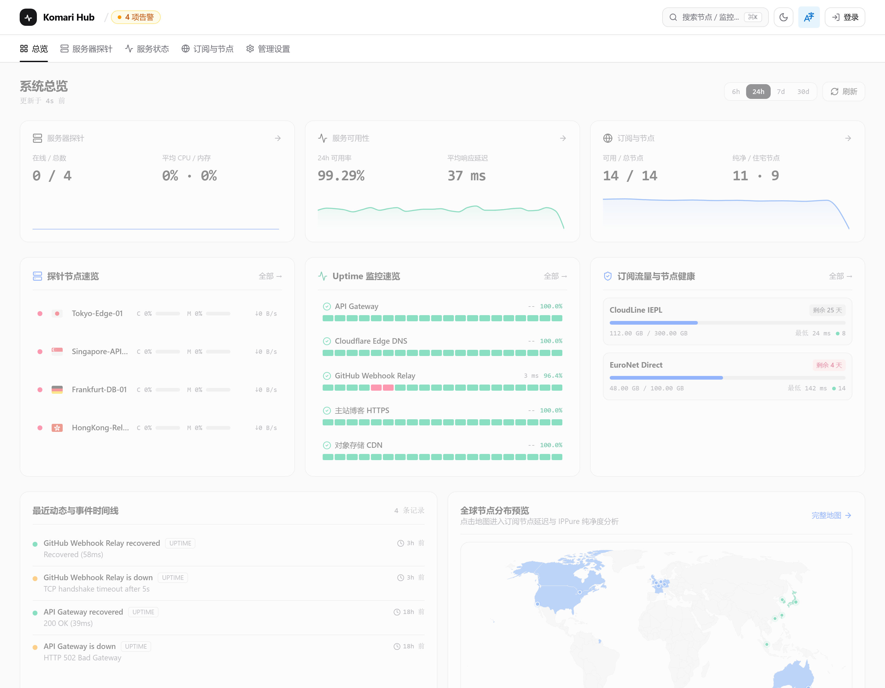

# PulseDeck

**All-in-one self-hosted infrastructure, service uptime, and proxy node observability deck.**

[English](./README.md) | [简体中文](./README_zh-cn.md) | [Docker Guide](./DOCKER.md)

PulseDeck is a unified self-hosted status hub forked from [Komari](https://github.com/komari-monitor/komari). It brings **real-time server probes**, **Uptime Kuma–style service monitoring**, and **Tower-inspired proxy subscription management (world map, speedtest, and IPPure IP purity checks)** together in a single clean, top-tabbed web interface — while keeping full support for Komari's official Theme Market inside the Server Probes tab.

> [!WARNING]
> PulseDeck is a self-hosted monitoring and management application. Deploy it only on infrastructure you own or are authorized to manage.

---

## Highlights

- **Unified Bento Overview (`/`)** — Cloudflare-inspired KPI cards with sparklines, live node summaries, compact uptime heartbeat strips, subscription traffic & expiry trackers, incident feed, and a global node distribution preview.
- **Server Probes + Komari Theme Market (`/servers`)** — Full Komari real-time WebSocket probe monitoring (CPU, RAM, disk, network, load, ping history, web terminal, admin dashboard). Install and switch any third-party theme from Komari's **Theme Market** in an isolated sandbox without hijacking the top tab bar or other tabs.
- **Service Uptime Monitoring (`/uptime`)** — Built-in lightweight checker (`HTTP/HTTPS`, `Keyword`, `TCP`, `Ping`) with 60-tick heartbeat bars, 30-day retention, latency charts, and automatic incident history — plus optional sync with external **Uptime Kuma** status pages.
- **Subscriptions, World Map, Speedtest & IPPure Purity (`/subscriptions`)** — Parse `Base64` / URI lines (`VMess`, `VLESS`, `Trojan`, `Shadowsocks`, `Hysteria2`, `TUIC`, `SOCKS5`, `HTTP`), `Clash / Mihomo YAML`, and `Sing-box JSON` subscriptions with traffic quota & expiry parsing (`Subscription-Userinfo`). Visualize nodes on an offline vector world map, run concurrent latency/speed tests, and check IP exit purity via `https://my.ippure.com/v1/info` (`fraudScore`, residential/datacenter, native/broadcast, ASN, city & coordinates).
- **Clean Top-Tab UX & Global `⌘K` Search** — Zero sidebar clutter, light/dark themes, and instant cross-module search across servers, uptime monitors, and subscription nodes.
- **Single Binary & Docker Ready** — Embedded React/Vite frontend packed into a single Go binary, or 1-command `docker compose up -d --build`.

---

## Screenshots

| Overview (`/`) | Server Probes (`/servers`) |
| :---: | :---: |
|  |  |

| Service Uptime (`/uptime`) | Subscriptions · Map · IPPure (`/subscriptions`) |
| :---: | :---: |
|  |  |

---

## Quick Start

### Docker Compose (Recommended)

```bash
git clone https://github.com/ArronHC/PulseDeck.git
cd PulseDeck
docker compose up -d --build
```

Open `http://127.0.0.1:25774` to complete the first-run setup wizard. See [DOCKER.md](./DOCKER.md) for custom ports, persistent volumes, and optional `sing-box` / `mihomo` proxy core integration for encrypted-node IPPure checks.

### Build From Source

Requirements: **Go 1.25+**, **Node.js 22+**, and a C compiler (`gcc`) for SQLite CGO.

```bash
./build.sh
./pulsedeck server
```

Default listen address is `0.0.0.0:25774` (override with `KOMARI_LISTEN=127.0.0.1:25774`).

---

## Acknowledgments

PulseDeck builds upon and takes inspiration from these great projects:

- [komari-monitor/komari](https://github.com/komari-monitor/komari) & [komari-web](https://github.com/komari-monitor/komari-web) — Core server probe backend, agent protocol, theme market, and admin engine.
- [louislam/uptime-kuma](https://github.com/louislam/uptime-kuma) — Uptime heartbeat bar UX and status page sync compatibility.
- [pengchujin/tower](https://github.com/pengchujin/tower) — Subscription traffic/expiry tracking, offline region mapping, and node map inspiration.
- [IPPure](https://my.ippure.com/v1/info) — IP fraud score, residential/datacenter, and native/broadcast purity telemetry.

## License

See [LICENSE](./LICENSE) and [NOTICE](./NOTICE).
