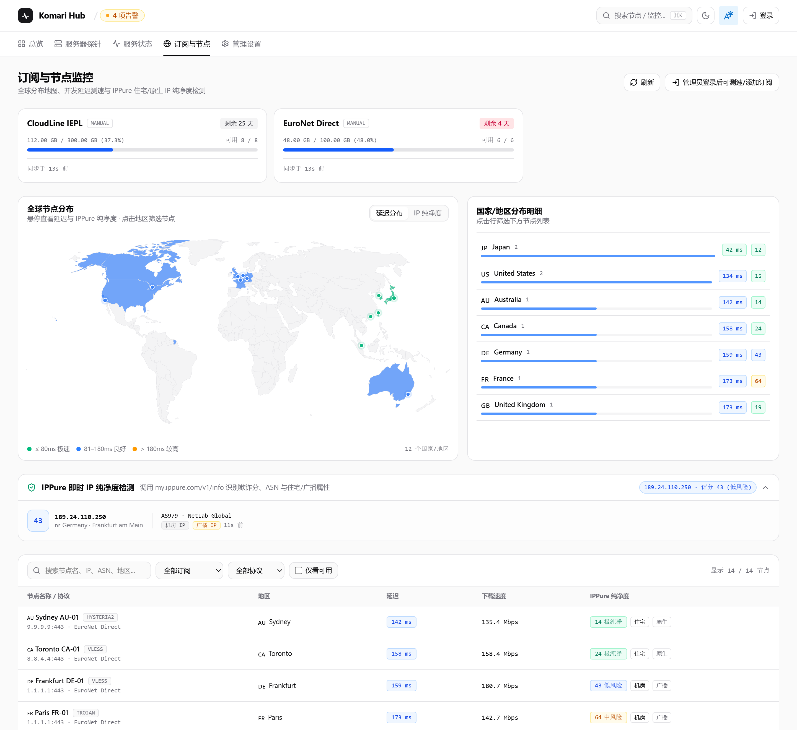
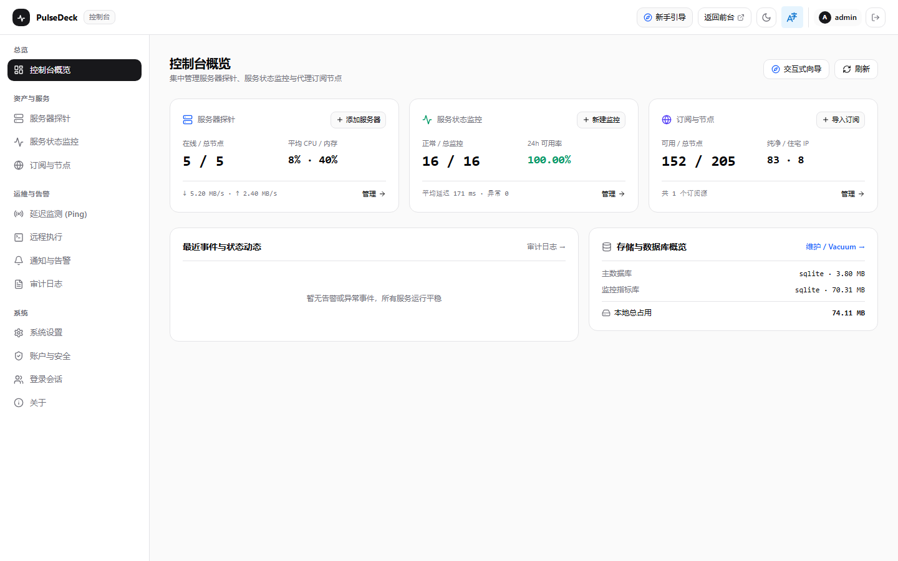
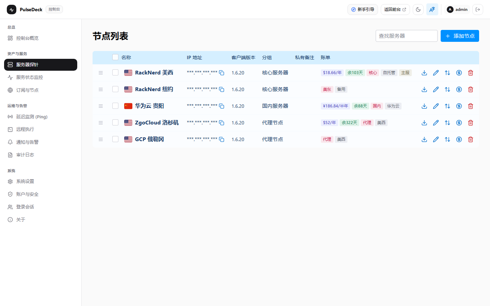
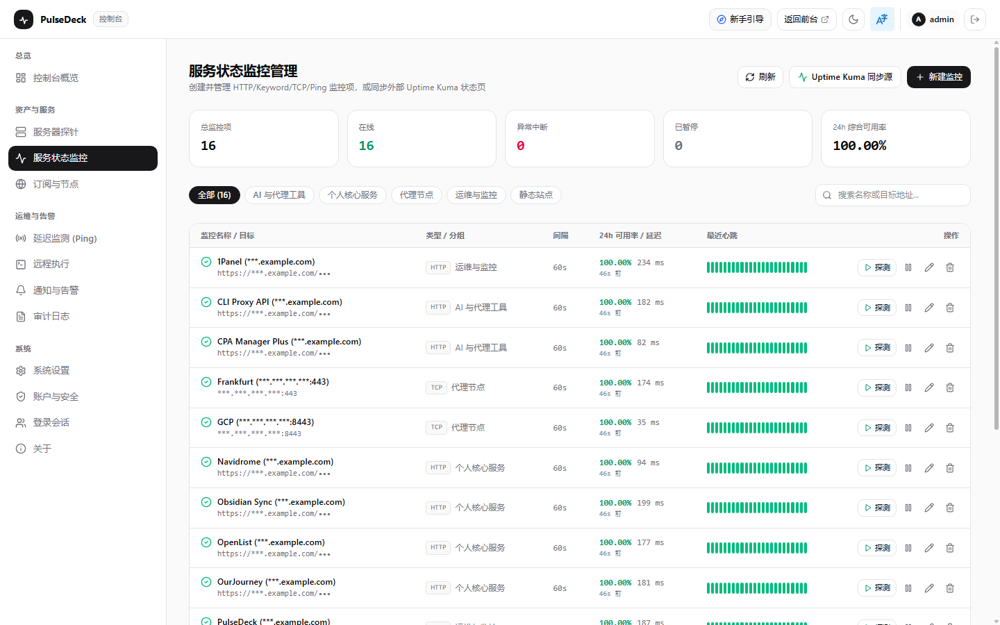

<div align="center">

<picture>
  <source media="(prefers-color-scheme: dark)" srcset="./assets/logo-dark.svg">
  <source media="(prefers-color-scheme: light)" srcset="./assets/logo-light.svg">
  
</picture>

**All-in-one self-hosted server probe, service uptime, and proxy node observability platform.**

[English](./README.md) | [简体中文](./README_zh-cn.md) | [Live Demo](https://demo.pd.arronhc.cc.cd) | [Docker Guide](./DOCKER.md) | [Upstream & Migration](./UPSTREAM.md)

</div>

> [!WARNING]
> PulseDeck is a self-hosted monitoring and management platform built on [komari-monitor/komari](https://github.com/komari-monitor/komari) (MIT). Deploy it only on infrastructure you own or are authorized to manage.

---

## Quick Deploy & Demo

### 1-Command Docker Compose (Full Edition — Ready Out of the Box)

```bash
git clone https://github.com/ArronHC/PulseDeck.git
cd PulseDeck
docker compose up -d
```

- **Full (`:latest` / `:full`)**: Includes embedded `mihomo` proxy core for out-of-the-box encrypted-node speedtests and IPPure exit purity checks.
- **Lite (`:lite`)**: Minimal footprint without an embedded proxy core (`PULSEDECK_IMAGE=ghcr.io/arronhc/pulsedeck:lite`).
- Open `http://127.0.0.1:25774` for the 5-step setup wizard, or configure `PULSEDECK_ADMIN_USER` & `PULSEDECK_ADMIN_PASS` in [docker-compose.yml](./docker-compose.yml) for headless initialization.

### Live Demo & Instant Synthetic Local Demo

- **Live Demo**: [https://demo.pd.arronhc.cc.cd](https://demo.pd.arronhc.cc.cd)
- Launch an isolated local demo with synthetic probes, monitors, and RFC 5737 subscription nodes (`PULSEDECK_DEMO=true`):

```bash
docker compose -f docker-compose.demo.yml up -d
```

---

## Screenshots

### Public Frontend (Read-Only)

| Overview (`/`) | Server Probes (`/servers`) |
| :---: | :---: |
|  |  |

| Service Uptime (`/uptime`) | Subscriptions · Map · IPPure (`/subscriptions`) |
| :---: | :---: |
|  |  |

### Admin Console (Backend)

| Admin Overview (`/admin/overview`) | Probe Management (`/admin/servers`) |
| :---: | :---: |
|  |  |

| Uptime Management (`/admin/uptime`) | Subscription & Speedtest Management (`/admin/subscriptions`) |
| :---: | :---: |
|  |  |

---

## Key Capabilities

- **Strict Read-Only Public Pages vs. Admin Console** — Public `/`, `/servers`, `/uptime`, and `/subscriptions` views strictly sanitize subscription URLs, credentials, node hosts, and server exit IPs. All management lives in `/admin/*`.
- **Server Probes (`/servers` & `/admin/servers`)** — Real-time Agent v2 telemetry (CPU, RAM, disk, network, load, ping tasks, traffic quotas, and billing tracking).
- **Service Uptime (`/uptime` & `/admin/uptime`)** — Built-in `HTTP/HTTPS`, `Keyword`, `TCP`, and `Ping` probes with 60-tick heartbeat strips, 30-day retention, incident timeline, and **Uptime Kuma** sync.
- **Subscriptions, World Map, Streaming Speedtest & IPPure Purity (`/subscriptions` & `/admin/subscriptions`)**:
  - Parses `Base64` / URI lines (`VMess`, `VLESS`, `Trojan`, `Shadowsocks`, `Hysteria2`, `TUIC`, `SOCKS5`, `HTTP`), `Clash / Mihomo YAML`, and `Sing-box JSON` with `Subscription-Userinfo` tracking.
  - **Honest Test Modes & Streaming Output**: Defaults to **user-network (browser) latency probing** and also supports **server-side SSE streaming** (`Proxy HTTP`, `Proxy Download`, `TCP Connect`), labeling each node's exact `test_method` (`代理延迟`, `下载测速`, `TCP 连通`, `TCP 回退`, `本机 HTTP/TCP`).
  - **Automated Schedules & Alerts**: Configurable per-subscription auto speedtests, periodic IPPure purity checks, subscription expiry alerts, and IP quality degradation alerts (fraud score jump / residential-to-datacenter or native-to-broadcast downgrade).
  - Multi-column sorting (latency, download speed, fraud score, region, name) and offline world map visualization.
- **Zero Bloat**: Legacy WebSSH/file-manager workbench, Theme Market, and runtime Plugin System are removed for security and cohesion.

---

## Route Map & Environment Variables

<details>
<summary>View Route Map & Configuration Variables</summary>

| Layer | Route | Purpose |
| :--- | :--- | :--- |
| **Setup** | `/install` | 5-step first-run wizard (deactivates permanently once completed) |
| **Public** | `/`, `/servers`, `/instance/:uuid`, `/uptime`, `/subscriptions` | Read-only observability & sanitized status views |
| **Admin** | `/admin/overview`, `/admin/servers`, `/admin/uptime`, `/admin/subscriptions` | Control center, probe/monitor/subscription management |
| **Ops & Settings** | `/admin/ping`, `/admin/exec`, `/admin/notification/*`, `/admin/logs`, `/admin/settings/*` | Ping tasks, 2FA-protected remote exec, alerts, audit logs & DB maintenance |

| Variable | Default | Description |
| :--- | :--- | :--- |
| `KOMARI_LISTEN` | `0.0.0.0:25774` | HTTP listen address and port |
| `PULSEDECK_ADMIN_USER` / `PASS` | *(unset)* | Optional headless first-run admin credentials |
| `PULSEDECK_SITENAME` / `DESCRIPTION` | `PulseDeck` | Headless first-run site branding |
| `PULSEDECK_PRIVATE_SITE` | `false` | Require login before viewing public status pages |
| `PULSEDECK_METRIC_DSN` | `./data/metrics.db` | SQLite path or PostgreSQL / TimescaleDB DSN |
| `PULSEDECK_DEMO` | `false` | Seed synthetic demo probes, monitors, and nodes when DB is empty |

</details>

---

## Build From Source & Komari Migration

- **Build From Source** (Go 1.25+, Node.js 22+, `gcc`):
  ```bash
  ./build.sh
  ./pulsedeck server
  ```
- **Migrating from Komari**: Upload your Komari `backup.zip` during `/install` or mount your existing Komari `./data` directory (`komari.db` + `metrics.db`). See [UPSTREAM.md](./UPSTREAM.md) and [DOCKER.md](./DOCKER.md) for migration steps, third-party license audit, and upstream security tracking.

## Community

[](https://linux.do/)

## Acknowledgments & License

Built upon [komari-monitor/komari](https://github.com/komari-monitor/komari) (MIT) and inspired by [louislam/uptime-kuma](https://github.com/louislam/uptime-kuma), [pengchujin/tower](https://github.com/pengchujin/tower), and [IPPure](https://my.ippure.com/v1/info). Licensed under [MIT](./LICENSE) — see [NOTICE](./NOTICE) and [UPSTREAM.md](./UPSTREAM.md).
