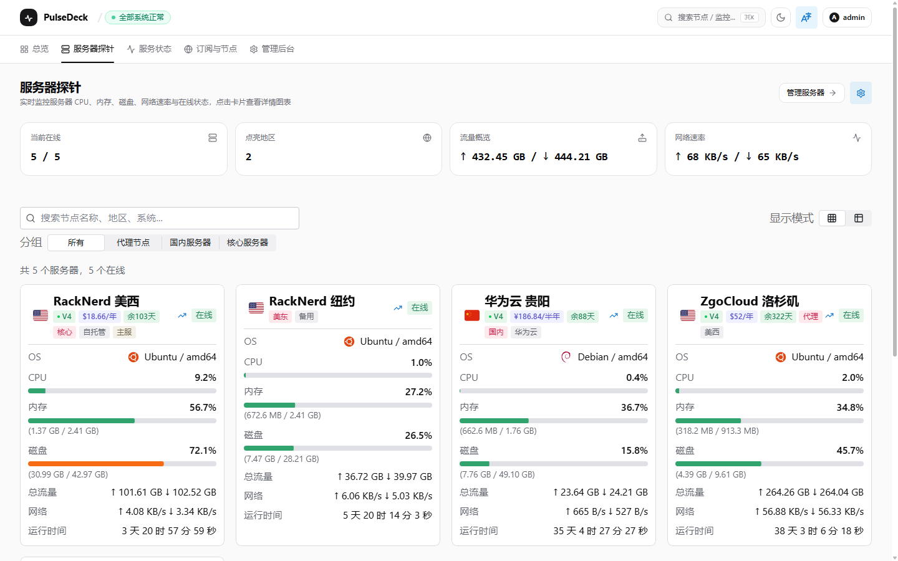
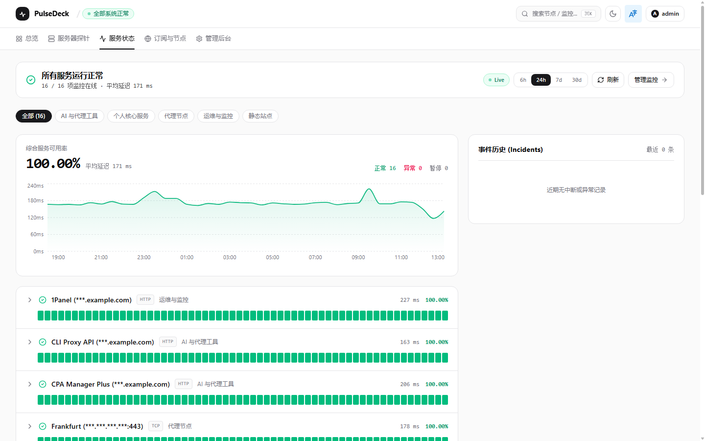
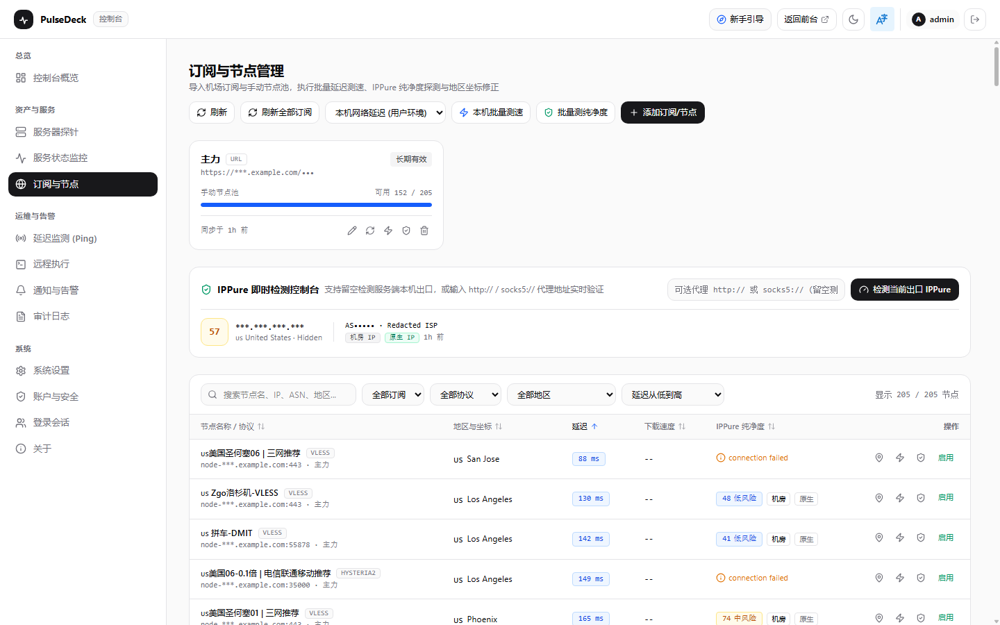

# PulseDeck

**All-in-one self-hosted infrastructure, service uptime, and proxy node observability platform.**

[English](./README.md) | [简体中文](./README_zh-cn.md) | [Docker Guide](./DOCKER.md)

PulseDeck is a self-hosted observability and network status platform built on [Komari](https://github.com/komari-monitor/komari)'s probe and metric store. It pairs **read-only public status pages** with a **dedicated Admin Console** for **Server Probes**, **Uptime Kuma–style Service Monitoring**, and **Tower-inspired Proxy Subscription Management (World Map, Speedtest & IPPure Purity)**.

> [!WARNING]
> PulseDeck is a self-hosted monitoring and management application. Deploy it only on infrastructure you own or are authorized to manage.

---

## Highlights

- **Strict Frontend / Backend Separation** — Public views (`/`, `/servers`, `/uptime`, `/subscriptions`) are 100% read-only with zero inline management clutter. Every server probe, uptime monitor, external Uptime Kuma source, proxy subscription, speedtest, IPPure check, and notification channel is managed centrally inside the **PulseDeck Admin Console** (`/admin/*`).
- **Interactive First-Run Setup & Onboarding** — Booting against an empty data directory launches a guided 5-step Web Setup Wizard (`/install`) with live password-strength checks, public/private visibility selection, and live metric database testing (`POST /api/install/test-db`). Upon completion, PulseDeck automatically signs in the admin and opens an interactive 4-step walkthrough plus a live DB-synced setup checklist in `/admin/overview`.
- **Unified Bento Overview (`/`)** — Cloudflare-inspired KPI cards with sparklines, live probe summaries, compact uptime heartbeat strips, subscription traffic & expiry trackers, incident feed, and a global node distribution preview.
- **Server Probes (`/servers` & `/admin/servers`)** — Real-time WebSocket probe telemetry (CPU, RAM, disk, network, load, ping latency tasks, traffic quotas, and billing/expiry tracking) powered by Komari's Agent v2 protocol — intentionally stripped of legacy WebSSH/file-manager workbench bloat.
- **Service Uptime Monitoring (`/uptime` & `/admin/uptime`)** — Lightweight built-in checker (`HTTP/HTTPS`, `Keyword`, `TCP`, `Ping`) with 60-tick heartbeat bars, 30-day retention, latency charts, and incident history, plus optional sync with external **Uptime Kuma** status pages.
- **Subscriptions, World Map, Speedtest & IPPure Purity (`/subscriptions` & `/admin/subscriptions`)** — Parse `Base64` / URI lines (`VMess`, `VLESS`, `Trojan`, `Shadowsocks`, `Hysteria2`, `TUIC`, `SOCKS5`, `HTTP`), `Clash / Mihomo YAML`, and `Sing-box JSON` with `Subscription-Userinfo` quota & expiry parsing. Explore nodes on an offline vector world map, run **user-network (browser) latency tests** or server-side **SSE streaming proxy/download speedtests** with live per-node progress updates, sort nodes by latency/speed/fraud score/region/name, and inspect exit IP purity via `https://my.ippure.com/v1/info` (`fraudScore`, residential vs. datacenter, native vs. broadcast, ASN, city & coordinates).
- **Clean Top-Tab UX & Global `⌘K` Search** — Zero sidebar clutter on public pages, light/dark modes, and instant cross-module search across servers, uptime monitors, and subscription nodes.
- **Single Binary & Docker Ready** — Embedded React/Vite frontend packed into a single Go binary, or 1-command `docker compose up -d` with prebuilt multi-arch GHCR images.

---

## Architecture & Route Map

| Layer | Route | Purpose |
| :--- | :--- | :--- |
| **First-Run Setup** | `/install` | 5-step interactive setup wizard (admin account, site visibility, live DB test, backup restore, auto-login) |
| **Public (Read-Only)** | `/` | Unified Bento overview across probes, uptime, subscriptions, events, and world map preview |
| **Public (Read-Only)** | `/servers`, `/instance/:uuid` | Real-time server probe list and per-host metric / ping history charts |
| **Public (Read-Only)** | `/uptime` | Global operational status banner, 60-tick heartbeat strips, latency chart, and incident timeline |
| **Public (Read-Only)** | `/subscriptions` | Masked subscription usage cards, interactive world map, country breakdown, and node purity table |
| **Admin Console** | `/admin/overview` | PulseDeck Control Center, interactive onboarding walkthrough & live setup checklist, storage summary |
| **Admin Console** | `/admin/servers` | Add/edit/remove probe servers, generate agent install scripts, configure auto-discovery, traffic & billing |
| **Admin Console** | `/admin/uptime` | Create/edit/pause/check Uptime monitors and manage external Uptime Kuma sync sources |
| **Admin Console** | `/admin/subscriptions` | Import URL subscriptions or manual nodes, run batch/per-node speedtests & IPPure purity checks, edit geo |
| **Admin Console** | `/admin/ping`, `/admin/exec`, `/admin/notification/*`, `/admin/logs` | Ping latency tasks, remote command execution, alert channels & rules, and audit logs |
| **Admin Console** | `/admin/settings/*`, `/admin/account`, `/admin/sessions` | Site settings, security, OAuth/SSO, 2FA, active sessions, and database maintenance/vacuum |

---

## Screenshots

### Public Frontend (Read-Only)

| Overview (`/`) | Server Probes (`/servers`) |
| :---: | :---: |
|  |  |

| Service Uptime (`/uptime`) | Subscriptions · Map · IPPure (`/subscriptions`) |
| :---: | :---: |
|  |  |

### Admin Console (Backend)

| Admin Overview (`/admin/overview`) | Probe Management (`/admin/servers`) |
| :---: | :---: |
|  |  |

| Uptime Management (`/admin/uptime`) | Subscription & Speedtest Management (`/admin/subscriptions`) |
| :---: | :---: |
|  |  |

---

## Quick Start

### Docker Compose (Recommended — Prebuilt Image, Zero Local Build)

```bash
git clone https://github.com/ArronHC/PulseDeck.git
cd PulseDeck
docker compose up -d
```

- Pulls the multi-arch GHCR image (`ghcr.io/arronhc/pulsedeck:latest`), ready in seconds even on 512 MB RAM VPSes.
- Open `http://127.0.0.1:25774` to walk through the 5-step interactive setup wizard, or set `PULSEDECK_ADMIN_USER` & `PULSEDECK_ADMIN_PASS` in `docker-compose.yml` for zero-click headless initialization.
- Need a local source build or embedded `sing-box` / `mihomo` proxy core for encrypted-node IPPure checks? See [DOCKER.md](./DOCKER.md).

### Build From Source

Requirements: **Go 1.25+**, **Node.js 22+**, and a C compiler (`gcc`) for SQLite CGO.

```bash
./build.sh
./pulsedeck server
```

Default listen address is `0.0.0.0:25774` (override with `KOMARI_LISTEN=127.0.0.1:25774`).

---

## Environment Variables

| Variable | Default | Description |
| :--- | :--- | :--- |
| `KOMARI_LISTEN` | `0.0.0.0:25774` | HTTP listen address and port |
| `PULSEDECK_ADMIN_USER` | *(unset)* | Optional headless first-run admin username (requires `PULSEDECK_ADMIN_PASS`) |
| `PULSEDECK_ADMIN_PASS` | *(unset)* | Optional headless first-run admin password (≥ 8 chars, upper + lower + digit) |
| `PULSEDECK_SITENAME` | `PulseDeck` | Site title used during headless initialization |
| `PULSEDECK_DESCRIPTION` | *(PulseDeck default)* | Site description used during headless initialization |
| `PULSEDECK_PRIVATE_SITE` | `false` | Set `true` to require login before viewing public status pages |
| `PULSEDECK_METRIC_DSN` | `./data/metrics.db` | Metric store DSN (local SQLite path or PostgreSQL / TimescaleDB DSN) |

---

## Acknowledgments

PulseDeck builds upon and takes inspiration from these great projects:

- Underlying probe backend, Agent v2 protocol, and metric store. [komari-monitor/komari](https://github.com/komari-monitor/komari)
- [louislam/uptime-kuma](https://github.com/louislam/uptime-kuma) — Uptime heartbeat bar UX and status page sync compatibility.
- [pengchujin/tower](https://github.com/pengchujin/tower) — Subscription traffic/expiry tracking, offline region mapping, and node map inspiration.
- [IPPure](https://my.ippure.com/v1/info) — IP fraud score, residential/datacenter, and native/broadcast purity telemetry.

## License

See [LICENSE](./LICENSE) and [NOTICE](./NOTICE).
