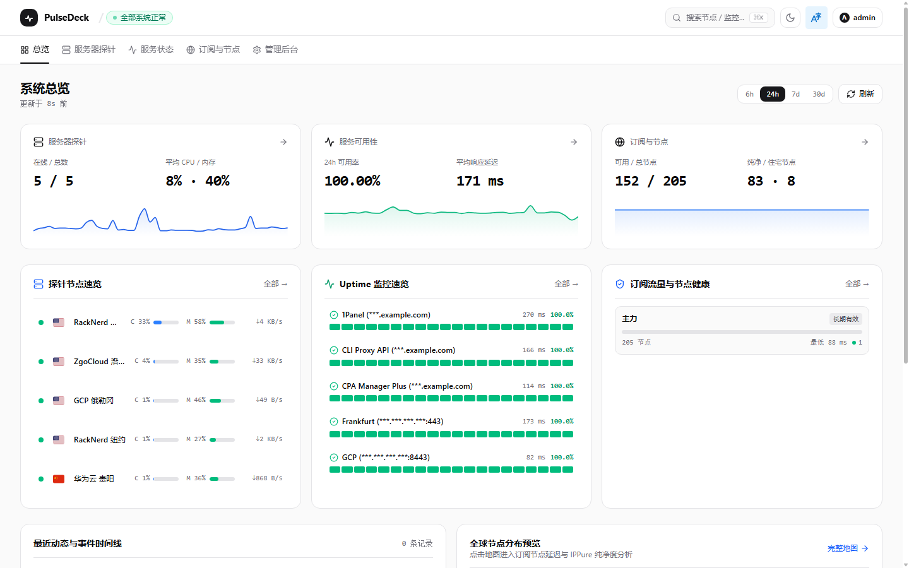
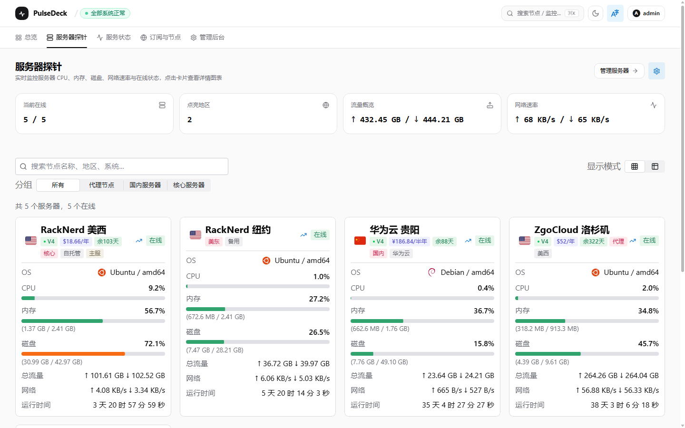
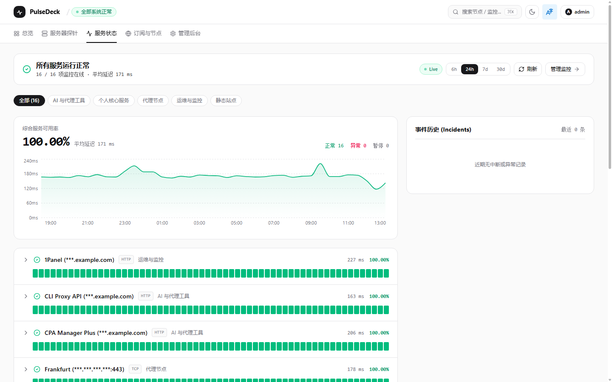
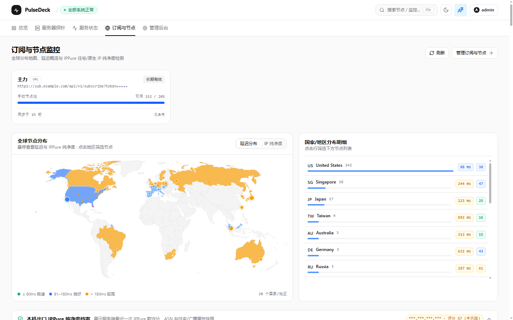
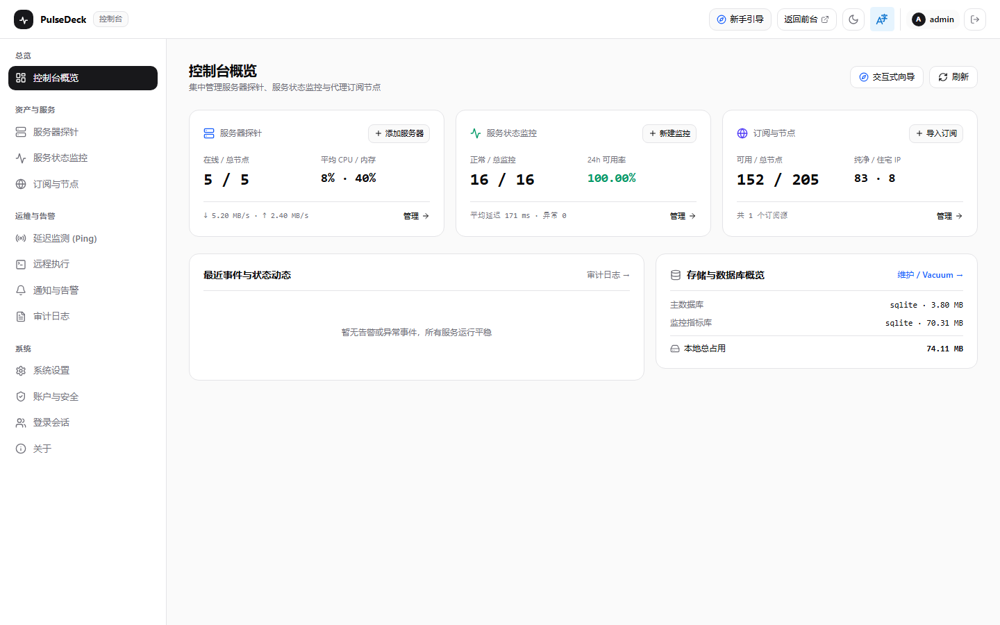
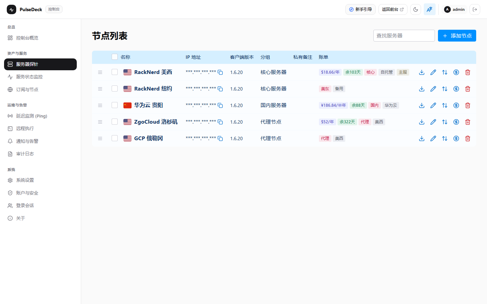
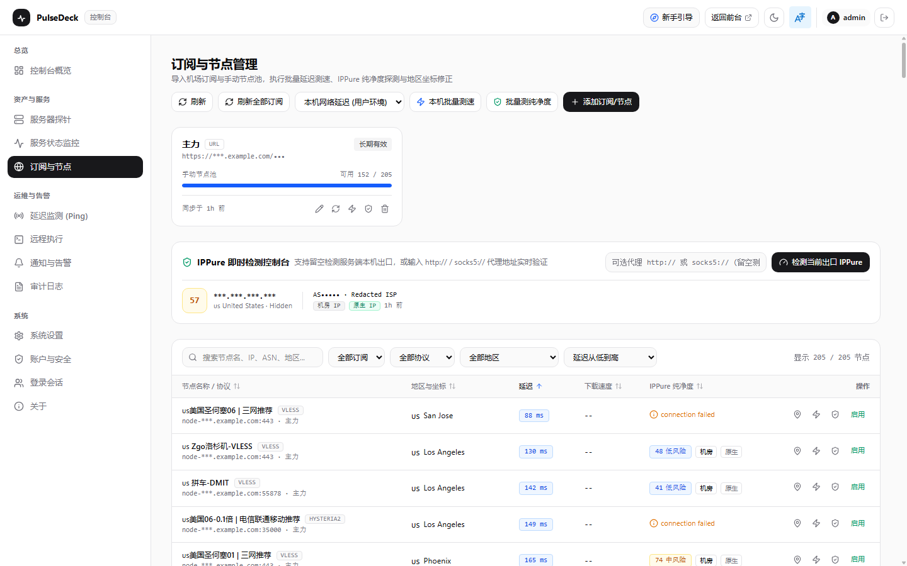

# PulseDeck

**全站运维与节点观测平台 —— 融合服务器探针、服务状态监控与代理订阅地图/测速/IP 纯净度检测的自托管聚合面板。**

[English](./README.md) | [简体中文](./README_zh-cn.md) | [Docker 部署指南](./DOCKER.md)

PulseDeck 是一款自托管观测与节点管理平台，使用 [Komari](https://github.com/komari-monitor/komari) 的底层探针与指标存储。系统提供**只读状态页和独立管理控制台**，统一整合**服务器探针**、**服务可用性监控（Uptime Kuma 风格）**与**代理订阅地图/测速/IPPure 纯净度检测（Tower 风格）**。

> [!WARNING]
> PulseDeck 是一款自托管监控与管理工具，请仅部署在你拥有或已获得授权管理的服务器与网络环境中。

---

## 核心特性

- **严格前后台职责分离**。公开前台（`/`、`/servers`、`/uptime`、`/subscriptions`）为只读状态页。服务器探针节点、Uptime 监控项、外部 Uptime Kuma 同步源、代理订阅导入、并发测速、IPPure 检测和通知告警均在 **PulseDeck 管理控制台**（`/admin/*`）管理。
- **首次运行交互式安装向导与新手引导**：
  - 首次空库启动自动进入 **5 步交互式初始化向导（`/install`）**，支持实时密码强度检查清单、公开/私有站点访问控制、界面语言选择、指标数据库实时连通测试（`POST /api/install/test-db`）及 `.zip` 备份恢复。
  - 初始化完成自动签发管理员登录态并直达 `/admin/overview`，弹出 **4 步交互式快速上手向导**，同时展示与数据库实时同步的初始化进度清单（`/api/admin/onboarding`），并可随时通过后台顶栏「新手引导」重开。
- **总览 Bento 仪表盘（`/`）**：参考 Cloudflare 模块化总览风格，一屏展示探针在线与资源负载、Uptime 24h 可用率与延迟、订阅节点可用率与纯净度占比、最近事件时间线及全球节点分布预览。
- **服务器探针（`/servers` & `/admin/servers`）**：基于 Komari Agent v2 底层引擎，提供实时 WebSocket 负载监控、历史曲线、分组管理、Ping 延迟任务、流量配额与账单到期提醒；移除了冗余的远程工作台（WebSSH/文件管理器）。
- **服务状态监控（`/uptime` & `/admin/uptime`）**：内置轻量级探测引擎（支持 `HTTP/HTTPS`、`关键词`、`TCP`、`Ping`），提供 **60 格心跳色块条**、响应耗时曲线、30 天历史保留与故障事件时间线；支持同步外部 **Uptime Kuma** 状态页。
- **订阅管理 · 世界地图 · 测速 · IPPure 纯净度（`/subscriptions` & `/admin/subscriptions`）**：
  - 支持 `Base64` / URI 节点行（`VMess / VLESS / Trojan / Shadowsocks / Hysteria2 / TUIC / SOCKS5 / HTTP`）、`Clash / Mihomo YAML`、`Sing-box JSON` 订阅解析，自动读取 `Subscription-Userinfo` 展示流量进度与到期倒计时，前台对订阅链接与凭证严格脱敏。
  - 内置离线地区识别与矢量**世界地图**（支持「延迟分布 / IP 纯净度」双视图切换与悬停浮窗，点击国家联动筛选节点），前后台均支持按延迟、下载速度、IPPure 欺诈分、名称与地区进行排序。
  - 在后台默认采用**用户本机网络环境**进行实时流式延迟测速（单节点测完即刷新表格并同步持久化），也支持切换服务端 SSE 流式代理/下载测速、本机或指定代理即时 **IPPure 纯净度检测**（调用 `https://my.ippure.com/v1/info`，展示欺诈风险分 `fraudScore`、住宅/机房 IP、原生/广播 IP、ASN 与精准城市坐标）及节点地理信息校正。
- **全局 `⌘K` 快捷搜索与浅/深色切换**：前台无冗余侧边栏，支持跨模块即时搜索探针主机、Uptime 监控项与订阅节点。
- **单文件二进制 & Docker 一键部署**：前端构建后内嵌进 Go 单文件可执行程序，同时提供预构建双架构 GHCR 镜像与多阶段 `Dockerfile`。

---

## 架构与路由总览

| 分层 | 路由 | 功能说明 |
| :--- | :--- | :--- |
| **首次引导** | `/install` | 5 步交互式初始化向导（管理员账户、站点可见性、实时数据库测试、备份恢复、自动登录） |
| **公开前台（只读）** | `/` | 三大模块聚合 Bento 总览、最近动态与全球节点分布预览 |
| **公开前台（只读）** | `/servers`、`/instance/:uuid` | 服务器实时探针列表与单机负载 / Ping 延迟历史图表 |
| **公开前台（只读）** | `/uptime` | 全局可用性横幅、60 格心跳条、综合延迟曲线与故障事件时间线 |
| **公开前台（只读）** | `/subscriptions` | 脱敏订阅配额卡片、交互式世界地图、地区明细与节点延迟/纯净度列表 |
| **管理控制台** | `/admin/overview` | PulseDeck 控制台概览、交互式新手向导与实时配置清单、数据库存储概览 |
| **管理控制台** | `/admin/servers` | 服务器探针增删改、Agent 一键安装命令、自动发现密钥、流量与账单配置 |
| **管理控制台** | `/admin/uptime` | Uptime 监控项增删改/启停/立即探测，以及外部 Uptime Kuma 同步源管理 |
| **管理控制台** | `/admin/subscriptions` | 订阅链接与手动节点导入、批量/单节点测速、IPPure 出口与节点纯净度检测、地理校正 |
| **管理控制台** | `/admin/ping`、`/admin/exec`、`/admin/notification/*`、`/admin/logs` | Ping 延迟任务、远程命令执行、告警通道与规则、系统审计日志 |
| **管理控制台** | `/admin/settings/*`、`/admin/account`、`/admin/sessions` | 站点设置、安全策略、OAuth/SSO、2FA、登录会话与数据库压缩维护 |

---

## 界面预览

### 公开前台（只读观测）

| 系统总览（`/`） | 服务器探针（`/servers`） |
| :---: | :---: |
|  |  |

| 服务状态（`/uptime`） | 订阅地图 · 测速 · IPPure 纯净度（`/subscriptions`） |
| :---: | :---: |
|  |  |

### 管理控制台（后台）

| 控制台概览（`/admin/overview`） | 探针节点管理（`/admin/servers`） |
| :---: | :---: |
|  |  |

| 服务监控管理（`/admin/uptime`） | 订阅测速与纯净度管理（`/admin/subscriptions`） |
| :---: | :---: |
|  |  |

---

## 快速开始

### Docker Compose 一键部署（推荐：拉取预构建镜像，零本地编译）

```bash
git clone https://github.com/ArronHC/PulseDeck.git
cd PulseDeck
docker compose up -d
```

- 默认拉取双架构预构建镜像 `ghcr.io/arronhc/pulsedeck:latest`，512MB 小内存 VPS 也能 10 秒拉起，无需本地编译。
- 启动后访问 `http://127.0.0.1:25774` 进入 5 步交互式初始化向导；也可在 `docker-compose.yml` 中配置 `PULSEDECK_ADMIN_USER` / `PULSEDECK_ADMIN_PASS` 实现零交互自动初始化。
- 如需本地源码构建或内嵌 `sing-box` / `mihomo` 代理核心以支持加密节点 IPPure 检测，详见 [DOCKER.md](./DOCKER.md)。

### 源码构建运行

需要环境：**Go 1.25+**、**Node.js 22+** 与 C 编译器（`gcc`，用于 SQLite CGO）。

```bash
./build.sh
./pulsedeck server
```

默认监听 `0.0.0.0:25774`（可通过环境变量 `KOMARI_LISTEN=127.0.0.1:25774` 修改）。

---

## 环境变量说明

| 变量名 | 默认值 | 说明 |
| :--- | :--- | :--- |
| `KOMARI_LISTEN` | `0.0.0.0:25774` | 服务端监听地址与端口 |
| `PULSEDECK_ADMIN_USER` | *(未设置)* | 可选，无头自动初始化的管理员用户名（需与密码同时配置） |
| `PULSEDECK_ADMIN_PASS` | *(未设置)* | 可选，无头自动初始化的管理员密码（至少 8 位，需含大小写字母与数字） |
| `PULSEDECK_SITENAME` | `PulseDeck` | 无头初始化时的默认站点名称 |
| `PULSEDECK_DESCRIPTION` | *(PulseDeck 默认简介)* | 无头初始化时的默认站点描述 |
| `PULSEDECK_PRIVATE_SITE` | `false` | 设为 `true` 时启用私有站点模式（前台需登录后浏览） |
| `PULSEDECK_METRIC_DSN` | `./data/metrics.db` | 指标数据库 DSN（本地 SQLite 路径或 PostgreSQL / TimescaleDB 连接串） |

---

## 致谢

- 底层服务器探针引擎、Agent v2 协议与指标存储。[komari-monitor/komari](https://github.com/komari-monitor/komari)
- [louislam/uptime-kuma](https://github.com/louislam/uptime-kuma) — 心跳状态条交互与状态页同步兼容。
- [pengchujin/tower](https://github.com/pengchujin/tower) — 订阅流量/到期管理、离线地区识别与世界地图灵感。
- [IPPure](https://my.ippure.com/v1/info) — IP 欺诈风险评分与住宅/原生属性检测接口。

## 开源协议

详见 [LICENSE](./LICENSE) 与 [NOTICE](./NOTICE)。
