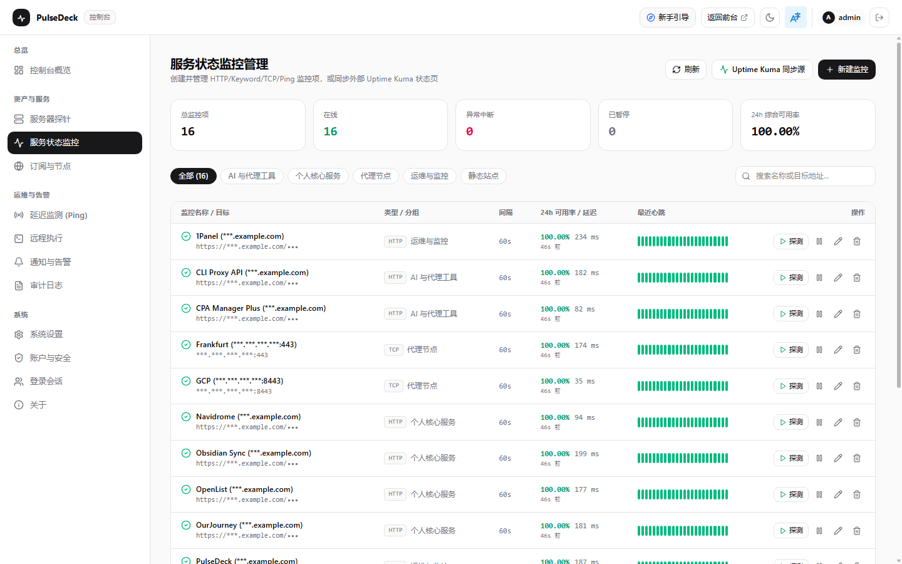

<div align="center">

<picture>
  <source media="(prefers-color-scheme: dark)" srcset="./assets/logo-dark.svg">
  <source media="(prefers-color-scheme: light)" srcset="./assets/logo-light.svg">
  
</picture>

**自托管全栈观测与节点管理平台 —— 融合服务器探针、服务可用性监控与代理订阅地图 / 流式测速 / IPPure 纯净度检测。**

[English](./README.md) | [简体中文](./README_zh-cn.md) | [在线演示](https://demo.pd.arronhc.cc.cd) | [Docker 部署指南](./DOCKER.md) | [上游关系与迁移指南](./UPSTREAM.md)

</div>

> [!WARNING]
> PulseDeck 基于 [komari-monitor/komari](https://github.com/komari-monitor/komari)（MIT）二次开发，请仅部署在你拥有或已获得授权管理的服务器与网络环境中。

---

## 快速部署与演示

### Docker Compose 一键部署（默认 Full 版，开箱即用）

```bash
git clone https://github.com/ArronHC/PulseDeck.git
cd PulseDeck
docker compose up -d
```

- **完整版（`:latest` / `:full`，默认）**：内置 `mihomo` 代理核心，开箱即用支持加密节点真实代理测速、下载测速与节点 IPPure 检测。
- **精简版（`:lite`）**：不含内置代理核心，极致轻量（`PULSEDECK_IMAGE=ghcr.io/arronhc/pulsedeck:lite`）。
- 启动后访问 `http://127.0.0.1:25774` 完成 5 步安装向导，或在 [docker-compose.yml](./docker-compose.yml) 中配置 `PULSEDECK_ADMIN_USER` 与 `PULSEDECK_ADMIN_PASS` 无交互初始化。

### 在线演示与一键本地 Demo

- **在线演示站**：[https://demo.pd.arronhc.cc.cd](https://demo.pd.arronhc.cc.cd)
- 本地也可使用内置 `PULSEDECK_DEMO=true` 虚拟数据种子模式一键拉起演示环境（采用 RFC 5737 保留 IP 与 `demo.example.com` 虚拟节点，零隐私泄露）：

```bash
docker compose -f docker-compose.demo.yml up -d
```

---

## 界面预览

### 公开前台（只读观测）

| 系统总览（`/`） | 服务器探针（`/servers`） |
| :---: | :---: |
|  |  |

| 服务状态（`/uptime`） | 订阅地图 · 测速 · IPPure 纯净度（`/subscriptions`） |
| :---: | :---: |
|  |  |

### 管理控制台（后台）

| 控制台概览（`/admin/overview`） | 探针节点管理（`/admin/servers`） |
| :---: | :---: |
|  |  |

| 服务监控管理（`/admin/uptime`） | 订阅测速与纯净度管理（`/admin/subscriptions`） |
| :---: | :---: |
|  |  |

---

## 核心特性

- **严格前后台分离与隐私脱敏**：公开前台（`/`、`/servers`、`/uptime`、`/subscriptions`）100% 只读，严格脱敏订阅链接、凭证、节点真实 Host 与服务端出口 IP；全部管理收口至 `/admin/*`。
- **服务器探针（`/servers` & `/admin/servers`）**：基于 Komari Agent v2 协议采集实时负载、Ping 延迟任务、流量配额与账单到期追踪。
- **服务状态监控（`/uptime` & `/admin/uptime`）**：内置 `HTTP/HTTPS`、`关键词`、`TCP`、`Ping` 探测引擎，60 格心跳色块条、30 天历史保留、故障时间线与 **Uptime Kuma** 状态同步。
- **订阅地图 · 流式测速 · 自动化告警（`/subscriptions` & `/admin/subscriptions`）**：
  - 支持 `Base64`/URI（`VMess / VLESS / Trojan / Shadowsocks / Hysteria2 / TUIC / SOCKS5 / HTTP`）、`Clash / Mihomo YAML`、`Sing-box JSON` 与 `Subscription-Userinfo` 流量/到期解析。
  - **测试方式清晰可辨 + 流式实时输出**：默认使用**用户本机网络环境**测速，同时支持**服务端 SSE 流式代理/下载/TCP 测速**；每个节点均清晰标注测试方式（`代理延迟` / `下载测速` / `TCP 连通` / `TCP 回退` / `本机 HTTP/TCP`），并支持按延迟、下载速度、欺诈分、名称与地区排序。
  - **真正自动化运维**：支持按订阅定时自动测速、定期 IPPure 纯净度巡检、**订阅到期提前告警**与 **IP 质量下降告警**（欺诈分跃升、住宅降级机房、原生降级广播）。
- **精简可控**：已移除冗余 WebSSH/文件管理器、主题市场与插件系统，缩小攻击面。

---

## 路由总览与环境变量

<details>
<summary>展开查看路由表与环境变量说明</summary>

| 分层 | 路由 | 功能说明 |
| :--- | :--- | :--- |
| **首次安装** | `/install` | 5 步初始化向导（完成后接口永久关闭返回 404） |
| **公开前台** | `/`、`/servers`、`/instance/:uuid`、`/uptime`、`/subscriptions` | 只读状态展示与隐私脱敏节点观测 |
| **管理后台** | `/admin/overview`、`/admin/servers`、`/admin/uptime`、`/admin/subscriptions` | 控制台概览、探针、Uptime、订阅测速与纯净度管理 |
| **运维配置** | `/admin/ping`、`/admin/exec`、`/admin/notification/*`、`/admin/logs`、`/admin/settings/*` | Ping 任务、2FA 保护的远程执行、告警通道、审计日志与数据库维护 |

| 变量名 | 默认值 | 说明 |
| :--- | :--- | :--- |
| `KOMARI_LISTEN` | `0.0.0.0:25774` | 服务端监听地址与端口 |
| `PULSEDECK_ADMIN_USER` / `PASS` | *(未设置)* | 可选，无头自动初始化管理员账号与密码 |
| `PULSEDECK_SITENAME` / `DESCRIPTION` | `PulseDeck` | 无头初始化时的站点名称与简介 |
| `PULSEDECK_PRIVATE_SITE` | `false` | 设为 `true` 时前台需登录后浏览 |
| `PULSEDECK_METRIC_DSN` | `./data/metrics.db` | 指标数据库 DSN（SQLite 或 PostgreSQL / TimescaleDB） |
| `PULSEDECK_DEMO` | `false` | 空库启动时是否自动填充虚拟演示数据 |

</details>

---

## 源码构建与 Komari 数据迁移

- **源码构建**（需 Go 1.25+、Node.js 22+、`gcc`）：
  ```bash
  ./build.sh
  ./pulsedeck server
  ```
- **从 Komari 迁移**：支持在 `/install` 直接上传 Komari `backup.zip` 恢复，或挂载原有 `./data` 目录自动升级表结构；详见 [UPSTREAM.md](./UPSTREAM.md) 与 [DOCKER.md](./DOCKER.md)（含第三方许可证核查与上游安全更新跟进流程）。

## Community

[](https://linux.do/)

## 致谢与开源协议

基于 [komari-monitor/komari](https://github.com/komari-monitor/komari)（MIT）二次开发，灵感与核心能力来自 [louislam/uptime-kuma](https://github.com/louislam/uptime-kuma)、[pengchujin/tower](https://github.com/pengchujin/tower) 与 [IPPure](https://my.ippure.com/v1/info)。本项目采用 [MIT](./LICENSE) 协议开源，详见 [NOTICE](./NOTICE) 与 [UPSTREAM.md](./UPSTREAM.md)。
